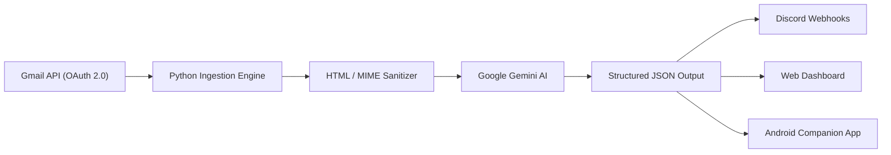

# BriefingOS — AI-Powered Email Briefing & Intelligence Pipeline

> An automated email intelligence assistant that ingests Gmail threads, extracts and sanitizes raw email payloads, and synthesizes executive briefings and action items using **Google Gemini AI**.

---

## Overview

Managing high-volume inboxes leads to missed action items and cognitive overload. **BriefingOS** transforms messy, multi-paragraph email threads into structured, high-signal intelligence digests delivered directly to your dashboard, Discord channel, and mobile device.



---

## Key Features

- **Secure Google OAuth 2.0 Ingestion:** Connects directly with the Gmail REST API with token refresh handling and credential isolation.
- **Robust MIME & HTML Sanitization:** Handles multi-part MIME payloads, decodes base64-encoded email stubs, and parses nested HTML into clean plain text using BeautifulSoup.
- **Gemini-Powered Intelligence:** Prompts Google Gemini with strict schema constraints to generate:
  - **Priority Categorization:** Groups emails into *Important*, *Needs Attention*, and *Informational*.
  - **Action Checklist:** Automatically extracts pending action items, deadlines, and reasons.
  - **Executive Summaries:** Generates concise 2-line summaries for rapid scanning.
- **Dual Briefing Modes:**
  - **Morning Kickoff:** Focuses on pending actions and high-priority items to plan the workday.
  - **Evening Wrap-Up:** Highlights completed threads and remaining follow-ups.
- **Multi-Channel Delivery:** Real-time formatted Discord embed alerts, modern dark-themed web dashboard, and local JSON outputs.

---

## Architecture & Tech Stack

| Layer | Technologies |
| :--- | :--- |
| **Backend & Pipeline** | Python 3.11+, `google-genai`, `google-api-python-client`, `beautifulsoup4`, `requests` |
| **Authentication** | Google OAuth 2.0 (`credentials.json`, `token.json`) |
| **AI / LLM** | Google Gemini 3.8 Flash (Structured JSON output schema) |
| **Notifications** | Discord Webhooks (Rich embeds with status badges) |
| **Frontend & UI** | Tailwind CSS, Lucide icons, Responsive Web Dashboard |
| **Mobile Companion** | Kotlin, Jetpack Compose, Material 3 (One UI / Zinc Dark theme) |
| **Automation** | GitHub Actions (Daily cron schedule) |

---

## Repository Structure

```
ai-mail-assistant/
├── .github/workflows/          # Automated GitHub Actions daily briefing cron
├── android-app/                # Native Android client (Kotlin + Jetpack Compose)
├── gmail/
│   ├── gmail.py                # Gmail API ingestion & Gemini AI processing engine
│   └── data.json               # Structured output (briefings + sanitized email details)
├── discord_notifier.py         # Formats and delivers Discord rich embed notifications
├── index.html                  # Modern responsive web dashboard
├── serve.py                    # Local dashboard server
├── requirements.txt            # Python dependencies
└── .env.example                # Environment variables template
```

---

## Getting Started

### 1. Prerequisites
- Python 3.10+
- Google Cloud Project with the **Gmail API** enabled
- Google Gemini API Key

### 2. Installation
```bash
# Clone the repository
git clone https://github.com/Preetham37/ai-mail-assistant.git
cd ai-mail-assistant

# Install Python dependencies
pip install -r requirements.txt
```

### 3. Configuration
Copy the sample environment file and configure your credentials:
```bash
cp .env.example .env
```
Fill in `.env`:
```ini
GEMINI_API_KEY="your-gemini-api-key"
DISCORD_WEBHOOK_URL="your-discord-webhook-url"
```

Place your `credentials.json` (OAuth 2.0 Client ID from Google Cloud Console) into the `gmail/` directory.

### 4. Running the Pipeline
```bash
# Ingest emails, process with Gemini, and generate briefings
python gmail/gmail.py

# Send Discord notifications
python discord_notifier.py

# Launch the local dashboard
python serve.py
```
Open `http://localhost:8080` in your browser to view your AI briefing dashboard.

---

## Security & Privacy

- No email bodies or OAuth tokens are committed to version control (`.gitignore` excludes sensitive files).
- Processed data is stored locally in `gmail/data.json` for client display.

---

## Author
**Preetham**
- GitHub: [@Preetham37](https://github.com/Preetham37)
- Email: [mpreetam792@gmail.com](mailto:mpreetam792@gmail.com)
